<!-- _class: lead -->

# How do you know a change is safe when most of what you ship is code your team never wrote?

**You don't. The AI Test Harness gives you the evidence.**

**Every change arrives with proof.** Tests that ran on both sides of the change and a signed record, on the pull request, for your own code and every package you depend on. The gate decides on evidence, not trust.

**Known vulnerabilities get an answer, not a claim.** Proven fixed, proven exposed, or shown unreachable, each backed by a test anyone can rerun, and a VEX draft that rests on it.

**A test suite that grows where none existed.** The tests nobody will write by hand get written, run and scored; the ones that earn their keep join your suite, and the review time it costs is measured on every run.

**Proof that travels with the product.** Signed records your customers, auditors and regulators can verify, and no silent coverage: every behaviour a change reaches is validated, handed to you, or named as a gap with its reason.

**The ask:** a six-week pilot on two projects, a named sponsor, a compute budget priced in your own tokens.

---

# How it works: the flow, the data, and why

```mermaid
flowchart LR
    subgraph IN[What it reads, and why]
        direction TB
        R[Repository and two refs<br/><i>what changed</i>]
        G[Dependency graph at both versions<br/><i>which packages moved, how deep</i>]
        A[Advisories, OSV<br/><i>what is already known to be wrong</i>]
        API[Public API and its diff, call sites<br/><i>what we use and what changed under us</i>]
        W[Behaviour worklist, security lint<br/><i>every result a test should check</i>]
        CI[The repository's CI and existing suite<br/><i>what is already covered, what the pipeline can validate</i>]
    end
    subgraph DO[What it does]
        direction TB
        S0[0 Self-check<br/>28 register checks, probes]
        S1[1 Intake<br/>work list by depth and risk]
        S2[2 Analysis<br/>facts, never guesses]
        S3[3 Generation<br/>model writes tests; survivors of deliberate breakage go back once]
        S4[4 Sealed execution<br/>both versions, five runs, mutation, differential]
        S5[5 Triage and accounting<br/>class, confidence, route; three states]
        S0 --> S1 --> S2 --> S3 --> S4 --> S5
    end
    subgraph OUT[What comes out]
        direction TB
        PK[Review packet and test pull request<br/><i>a person merges</i>]
        VX[Draft VEX per advisory<br/><i>Product Security confirms</i>]
        REC[Signed record per test<br/><i>in-toto, SLSA, OpenVEX</i>]
        FB[7 Feedback<br/><i>decisions read back; models and prompts scored</i>]
    end
    IN --> S1
    S5 --> PK --> FB
    S5 --> VX
    S5 --> REC
    FB -.->|fitness table, failure register| S0
```

Every input is a fact from a tool, read as untrusted data. Every output names the file it was measured from.
