<!-- _class: lead -->

# AI Test Harness

**What.** AI writes the tests nobody will write by hand, for our own code and for every package we depend on. Every test runs in a sealed sandbox on both sides of the change, is scored, and reaches a person as signed evidence. The harness only tests: it never merges, fixes code, publishes or deletes.

**Why.** Most of what we ship is code we did not write, and nobody has tested it. Build platforms say what is in the product, not whether it works. AI-assisted development widens the gap: 98 percent more pull requests, 91 percent longer review per request (Faros AI, 2025). Regulators and customers ask what we verified, and for most of it the answer today is nothing.

**Where.** Inside the build platform a team already runs, beside the pull request, not in its critical path. Its verdict lands on the pull request as evidence the gate reads; the team's policy decides what holds a merge. Platform-agnostic: GitHub Actions, GitLab CI, Jenkins, Azure Pipelines, Tekton.

**How.** Eight stages: self-check, intake, analysis, generation, sealed execution, triage, review, feedback. Every behaviour a change reaches ends in one of three states, validated, for your environment, or a stated gap with its reason; nothing is silent. Fitness of every model and prompt is measured on a published table before it becomes a default, and the harness tests itself first: 28 known failure modes, each a check that runs before every run.

---

# How it works: the flow, the data, and why

```mermaid
flowchart LR
    subgraph IN[What it reads, and why]
        direction TB
        R[Repository and two refs<br/><i>what changed</i>]
        G[Dependency graph at both versions<br/><i>which packages moved, how deep</i>]
        A[Advisories, OSV<br/><i>what is already known to be wrong</i>]
        API[Public API and its diff, call sites<br/><i>what we use and what changed under us</i>]
        W[Behaviour worklist, security lint<br/><i>every result a test should check</i>]
        CI[The repository's CI and existing suite<br/><i>what is already covered, what the pipeline can validate</i>]
    end
    subgraph DO[What it does]
        direction TB
        S0[0 Self-check<br/>28 register checks, probes]
        S1[1 Intake<br/>work list by depth and risk]
        S2[2 Analysis<br/>facts, never guesses]
        S3[3 Generation<br/>model writes tests; survivors of deliberate breakage go back once]
        S4[4 Sealed execution<br/>both versions, five runs, mutation, differential]
        S5[5 Triage and accounting<br/>class, confidence, route; three states]
        S0 --> S1 --> S2 --> S3 --> S4 --> S5
    end
    subgraph OUT[What comes out]
        direction TB
        PK[Review packet and test pull request<br/><i>a person merges</i>]
        VX[Draft VEX per advisory<br/><i>Product Security confirms</i>]
        REC[Signed record per test<br/><i>in-toto, SLSA, OpenVEX</i>]
        FB[7 Feedback<br/><i>decisions read back; models and prompts scored</i>]
    end
    IN --> S1
    S5 --> PK --> FB
    S5 --> VX
    S5 --> REC
    FB -.->|fitness table, failure register| S0
```

Every input is a fact from a tool, read as untrusted data. Every output names the file it was measured from.
