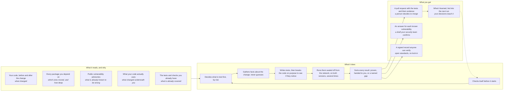

<!-- _class: lead -->

# How do you know a change is safe when most of what you ship is code your team never wrote?

**You don't. The AI Test Harness gives you the evidence.**

**Every change arrives with proof.** Tests run on both sides of the change and a signed record, on the pull request, for your code and every package you depend on. The gate decides on evidence, not trust.

**Known vulnerabilities get an answer, not a claim.** Proven fixed, proven exposed, or shown unreachable, each backed by a test anyone can rerun and a VEX draft that rests on it.

**A test suite that grows where none existed.** The tests nobody writes by hand get written, run and scored. The ones that earn their keep join your suite, and the review time they cost is measured on every run.

**Proof that travels with the product.** Signed records your customers, auditors and regulators can verify. No silent coverage: every behaviour a change reaches is validated, handed to you, or named as a gap with its reason.

Built in the open, with the teams that use it. Bring a project and shape what it proves next.

---

# How it works: what it reads, what it does, what you get

Everything it reads is a fact from a tool, treated as untrusted. Everything it tells you points to the file it was measured from.
