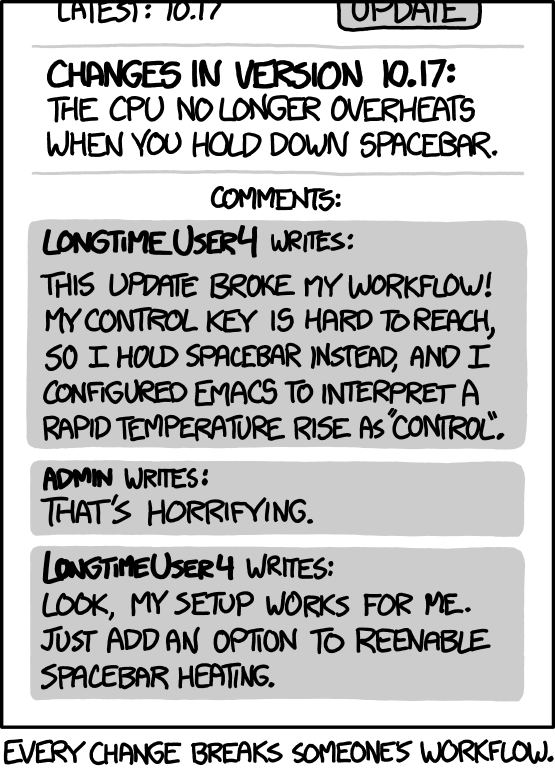

<!-- _class: one -->

# AI Test Harness

“Workflow” by Randall Munroe, xkcd.com/1172. Licensed CC BY-NC 2.5, creativecommons.org/licenses/by-nc/2.5. Unchanged.

Most of what a product ships is code its own team never wrote. Dependencies move, advisories land, and the tests that would prove a change is safe never get written, so the gate runs on trust.

The AI Test Harness writes those tests, runs them sealed on both sides of every change, and puts the evidence on the pull request: a signed record anyone can verify, an answer for every known vulnerability, and a plain account of what is proven, what is handed to you, and what is still a gap.

## Where it sits in your delivery flow

| Code | → | Pull request | → | Your CI | + | AI Test Harness *tests both versions, signs the evidence* | → | Gate *decides on evidence; either side can say no* | → | Merge | → | Build and release *signed records and VEX travel with it* |
|---|---|---|---|---|---|---|---|---|---|---|---|---|

An advisory or a dependency bump enters the same flow as a change, so a fix is proven the same way a feature is.

---

<!-- _class: two -->

# AI Test Harness

## From a change to evidence at the gate

The harness reads a change and everything it touches, writes the tests nobody will write by hand, and runs them sealed on both versions. Every behaviour the change reaches ends in one of three states. The evidence lands on the pull request, where a person and the gate decide.

### What it reads

| 1. Your change | 2. Your dependencies | 3. Known vulnerabilities | 4. Your existing tests |
|---|---|---|---|
| code before and after | every package, both versions | public advisories | what is already covered |
| what your code actually uses | how deep the change goes | what is already known to be wrong | what your pipeline can run |

▼

#### What it does

| Writes tests from facts, never guesses | Breaks the code on purpose to see if they notice | Runs them sealed, both versions, several times |
|---|---|---|

▼

#### Every behaviour the change reaches ends in one of three states

| Reached | What happened | State |
|---|---|---|
| `decode()` | the test catches the breakage | **Validated** |
| `upload()` | needs your network, not the sealed box | **Handed to you** |
| `native()` | no test survived scoring | **Named gap, with its reason** |

▼

### What you get, on the pull request

| The tests and their evidence | An answer per known vulnerability | A signed record anyone can verify |
|---|---|---|
| *a person decides to merge* | *a draft VEX your security team confirms* | *in-toto, SLSA, OpenVEX* |
